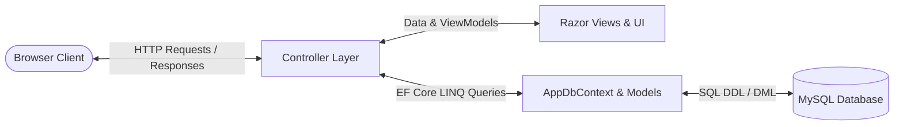
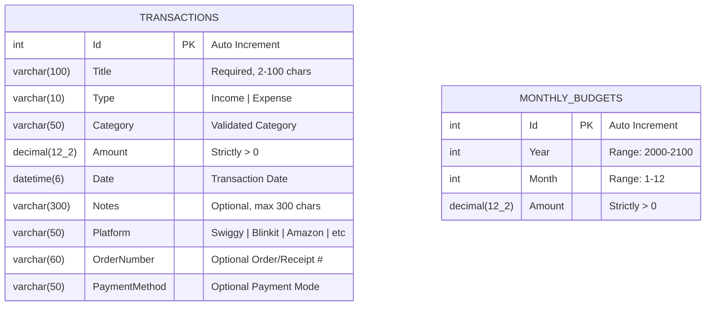

# Smart Purchase and Expense Tracker

An end-to-end, responsive **ASP.NET Core 8 MVC** web application engineered with **Entity Framework Core 8** and **MySQL** (via `Pomelo.EntityFrameworkCore.MySql`). Designed to centralize and track personal expenditures and purchases from **food delivery apps (Swiggy, Zomato)**, **grocery platforms (Blinkit, Zepto, Instamart, BigBasket)**, and **online shopping platforms (Amazon, Flipkart, Myntra)**, enforce monthly budget caps, calculate real-time net balances, and produce comprehensive **category-wise, platform-wise, monthly, and yearly financial reports** with interactive Chart.js visualizations.

---

## 📌 Problem Statement

Individuals and students today order frequently across multiple mobile and web applications—food delivery (Swiggy/Zomato), quick-commerce groceries (Blinkit/Zepto/Instamart), and e-commerce shopping (Amazon/Flipkart/Myntra). Because transactions are fragmented across disjointed app histories and bank SMS alerts, users quickly lose track of where their money is actually going. A unified **Smart Purchase and Expense Tracker** is essential to centralize purchases, track order numbers, categorize expenses by app/platform, monitor monthly budget allowances, and generate actionable financial reports.

---

## 🎯 Objectives

1. Implement a complete **Model-View-Controller (MVC)** web application using **ASP.NET Core 8**.
2. Centralize purchases from food delivery, grocery quick-commerce, and e-commerce shopping platforms alongside regular income and expenditures.
3. Persist financial records reliably in a **MySQL** relational database (`expense_tracker_db`) using **Entity Framework Core 8 Code-First Migrations** with automatic resilient failover for local offline demonstrations.
4. Provide robust **Create, Read, Update, and Delete (CRUD)** operations for purchases, income records, and monthly budget allocations.
5. Provide dedicated **Platform-wise, Category-wise, Monthly, and Yearly Financial Reports** with multi-dimensional analytics.
6. Enforce strict **server-side model validation** and **client-side unobtrusive validation** to safeguard data integrity.
7. Demonstrate multi-tiered **state management** using `ISession`, `TempData`, and `Query Strings`.
8. Deliver a polished, **responsive Bootstrap 5 user interface** featuring dynamic progress indicators and Chart.js analytics.

---

## 🌟 Main Features

- **Centralized Platform & Purchase Tracking**:
  - Centralize orders from **Food Delivery** (Swiggy, Zomato, EatSure, Uber Eats), **Quick Grocery** (Blinkit, Zepto, Instamart, BigBasket, DMart), **Online Shopping** (Amazon, Flipkart, Myntra, Meesho, Nykaa, Ajio), and Direct In-Store purchases.
  - Track optional **Order / Receipt Numbers** (e.g., `#SWIGGY-8941`, `OD12345678`) and **Payment Methods** (UPI, Credit/Debit Card, Net Banking, COD).
  - Quick-preset platform selector buttons for rapid entry.
- **Dedicated Reports & Analytics Hub (`/Reports`)**:
  - **Platform-wise Breakdown**: Spending share, total orders, average order value, and top category per app.
  - **Category-wise Breakdown**: Category distribution with interactive doughnut charts.
  - **Monthly Financial Reports**: In-depth breakdown for any selected month and year.
  - **Yearly Financial Reports**: Full 12-month summary table (Jan–Dec) with Net Savings, Monthly Budgets, Peak Spend Month highlights, and 12-month Income vs. Expense comparative bar chart.
  - **Print / PDF Export**: One-click print-optimized financial statement.
- **Executive Financial Dashboard**:
  - Live metric summary cards for **Total Income**, **Total Purchases / Expenses**, **Net Balance**, and **Monthly Budget**.
  - Dynamic **Budget Consumption Bar** that transitions across status states:
    - Normal usage (<80%): Vibrant Green (`bg-success`)
    - Warning threshold (80%–100%): Amber Warning (`bg-warning`)
    - Over-budget condition (>100%): Crimson Danger (`bg-danger`) with explicit over-budget amounts.
  - Interactive **Category Doughnut Chart** and **6-Month Trend Overview Bar Chart**.
  - Recent purchase table with branded platform badges and direct Edit controls.
- **Transaction Management**:
  - Record earnings and expenditures with platforms, categories, order IDs, dates, and amounts.
  - Multi-parameter filtering via Query Strings (Year, Month, Type, Category, Platform, and keyword search).
  - Post-Redirect-Get (PRG) workflow with dismissible notification banners.
  - Protected deletion requiring explicit user confirmation.
- **Monthly Budget Management**:
  - Set specific monthly spending allowances per calendar year.
  - Application-level and database-level unique constraints preventing duplicate monthly entries.
  - Decoupled lifecycle: deleting a budget cap never cascades to or destroys transaction records.
- **Multi-Device Responsiveness**:
  - Fully mobile-friendly layout utilizing Bootstrap 5 flexbox and grid utilities.
  - Responsive tables with horizontal scrolling containers (`table-responsive`) preventing viewport clipping.
  - Accessible design combining colors, icons, and signed values (`+₹` / `-₹`).

---

## 💻 Technology Stack

| Layer | Component | Specification |
| :--- | :--- | :--- |
| **Backend Framework** | ASP.NET Core MVC | .NET 8.0 (`net8.0`), C# 12 |
| **Data Access / ORM** | Entity Framework Core 8 | `Microsoft.EntityFrameworkCore` 8.0.11 |
| **Database Provider** | Pomelo MySQL Provider | `Pomelo.EntityFrameworkCore.MySql` 8.0.2 |
| **Database Engine** | MySQL Server / MariaDB | MySQL 8.0+ / XAMPP v3.3+ |
| **Database Migrations** | EF Core CLI Tools | `Microsoft.EntityFrameworkCore.Tools` 8.0.11 |
| **Frontend Framework** | Bootstrap 5 | Bootstrap v5.3.3 & Bootstrap Icons v1.11.3 |
| **Data Visualization** | Chart.js | Chart.js v4.4.4 (UMD) |
| **Scripting & DOM** | JavaScript & jQuery | jQuery 3.7.1, jQuery Validation & Unobtrusive |
| **Unit Testing** | xUnit Test Framework | xUnit 2.9.3, .NET Test SDK 17.14.1 |

---

## 🏗️ MVC Architecture Explanation

The project strictly follows the standard ASP.NET Core Model-View-Controller design pattern:



1. **Models (`Models/` & `ViewModels/`)**:
   - Encapsulate the application's domain entities, business logic, data constraints, and presentation calculations.
   - `Transaction.cs`: Entity mapping to the `Transactions` database table.
   - `MonthlyBudget.cs`: Entity mapping to the `MonthlyBudgets` database table with unique `(Year, Month)` index.
   - `TransactionCategories.cs`: Domain authority defining valid categories for Income and Expense.
   - `DashboardViewModel.cs`: Computes `NetBalance`, `BudgetRemaining`, `BudgetUsagePercentage`, and progress bar CSS classes.
2. **Views (`Views/`)**:
   - Razor templates (`.cshtml`) compiled dynamically into HTML.
   - Clean separation into feature folders (`Dashboard`, `Transactions`, `Budgets`, `Shared`).
   - Reusable partial views: `_Form.cshtml` for DRY form rendering, `_AlertsPartial.cshtml` for TempData alerts, and `_ValidationScriptsPartial.cshtml` for client-side scripts.
3. **Controllers (`Controllers/`)**:
   - Coordinate application flow, handle incoming HTTP requests, interact with `AppDbContext`, apply business validation, manage state (`ISession`, `TempData`), and return appropriate `IActionResult` responses.
   - `DashboardController`: Handles data aggregation, month/year session state, and chart data formatting.
   - `TransactionsController`: Asynchronously executes CRUD operations with query filtering and category validation.
   - `BudgetsController`: Enforces budget caps, duplicate validation, and period management.
   - `HomeController`: Manages root redirection and global error diagnostics.

---

## 📁 Project Folder Structure

```text
PersonalExpenseTracker/
├── Controllers/
│   ├── BudgetsController.cs         # Monthly Budget CRUD & uniqueness logic
│   ├── DashboardController.cs       # Metrics aggregation, platform widgets & Session state
│   ├── HomeController.cs            # Root route redirect & error handling
│   ├── ReportsController.cs         # Dedicated Platform, Category, Monthly & Yearly reports
│   └── TransactionsController.cs    # Transaction CRUD, platform & category filtering
├── Data/
│   └── AppDbContext.cs              # EF Core context, precision & model constraints
├── Migrations/
│   ├── 20261028135411_InitialCreate.cs
│   └── AppDbContextModelSnapshot.cs # EF Core model snapshot metadata
├── Models/
│   ├── ErrorViewModel.cs            # Request tracing error model
│   ├── MonthlyBudget.cs             # Domain model for monthly budget caps
│   ├── PaymentMethods.cs            # Standard payment options (UPI, Cards, COD, etc.)
│   ├── PurchasePlatforms.cs         # Supported platforms (Swiggy, Amazon, Blinkit, etc.)
│   ├── Transaction.cs               # Domain model with Platform, Order # & Payment Method
│   └── TransactionCategories.cs     # Predefined categories & validation rules
├── Properties/
│   └── launchSettings.json          # Local IIS Express & Kestrel port configs
├── ViewModels/
│   ├── DashboardViewModel.cs        # Metrics, formulas, platform & chart view models
│   └── ReportsViewModel.cs          # Multi-dimensional reporting data models
├── Views/
│   ├── Budgets/                     # Razor views for Monthly Budget management
│   ├── Dashboard/
│   │   └── Index.cshtml             # Financial dashboard, charts & recent items
│   ├── Reports/
│   │   └── Index.cshtml             # Platform & Category reports, 12-month table
│   ├── Shared/
│   │   ├── _AlertsPartial.cshtml    # TempData alert toast banner partial
│   │   ├── _Layout.cshtml           # Master layout with responsive navbar & CDNs
│   │   ├── _ValidationScriptsPartial.cshtml # jQuery validation scripts
│   │   └── Error.cshtml             # User-friendly error view
│   ├── Transactions/                # Razor views for Transaction management
│   │   ├── _Form.cshtml             # Smart transaction form with platform presets
│   │   ├── Create.cshtml            # New transaction recording page
│   │   ├── Delete.cshtml            # Delete confirmation page (POST-only delete)
│   │   ├── Edit.cshtml              # Edit transaction details page
│   │   └── Index.cshtml             # Filterable transaction table & search
│   ├── _ViewImports.cshtml          # Global TagHelper & namespace imports
│   └── _ViewStart.cshtml            # Master layout declarator
├── tests/
│   └── PersonalExpenseTracker.Tests/ # xUnit Automated Unit & Domain Test Project
│       ├── FunctionalAndDomainTests.cs # 37 passing automated unit tests
│       └── PersonalExpenseTracker.Tests.csproj
├── wwwroot/                         # Static assets (CSS, JS, Favicon)
├── appsettings.json                 # Connection string & application configuration
├── dotnet-tools.json                # Local dotnet-ef tool manifest
├── PersonalExpenseTracker.csproj    # Project dependencies & .NET 8 configuration
├── schema.sql                       # Standalone MySQL DDL export for manual DB import
└── README.md                        # Complete project documentation
```

---

## 🗄️ Database Design & Table Descriptions

The database schema is generated via EF Core Code-First and stored in MySQL under the database name `expense_tracker_db`.



### Table 1: `Transactions`
Stores each individual income or expense entry with platform source attribution.

| Column | Data Type | Constraints | Description |
| :--- | :--- | :--- | :--- |
| `Id` | `INT` | `PK`, `AUTO_INCREMENT` | Unique identifier for each transaction. |
| `Title` | `VARCHAR(100)` | `NOT NULL` | Description of the entry (2 to 100 characters). |
| `Type` | `VARCHAR(10)` | `NOT NULL` | Permitted values: `'Income'` or `'Expense'`. |
| `Category` | `VARCHAR(50)` | `NOT NULL` | Permitted category from `TransactionCategories`. |
| `Amount` | `DECIMAL(12,2)` | `NOT NULL` | Financial transaction value (strictly > 0). |
| `Date` | `DATETIME(6)` | `NOT NULL` | Calendar date of occurrence. |
| `Notes` | `VARCHAR(300)` | `NULL` | Optional transaction details (up to 300 chars). |
| `Platform` | `VARCHAR(50)` | `NULL`, Indexed | Platform / store (Swiggy, Blinkit, Amazon, etc.). |
| `OrderNumber`| `VARCHAR(60)` | `NULL` | Optional platform order / receipt ID. |
| `PaymentMethod`| `VARCHAR(50)`| `NULL` | Optional payment method (UPI, Card, COD, etc.). |
| `Type` | `VARCHAR(10)` | `NOT NULL` | Restricted strictly to `'Income'` or `'Expense'`. |
| `Category` | `VARCHAR(50)` | `NOT NULL` | Category name from `TransactionCategories`. |
| `Amount` | `DECIMAL(12,2)` | `NOT NULL`, `CHECK (Amount > 0)` | Monetary value with exact 2-decimal financial precision. |
| `Date` | `DATETIME(6)` | `NOT NULL` | Effective date of the transaction. |
| `Notes` | `VARCHAR(300)` | `NULLABLE` | Optional supplementary context or merchant details. |

### Table 2: `MonthlyBudgets`
Stores the target monthly spending limit per calendar month and year.

| Column | Data Type | Constraints | Description |
| :--- | :--- | :--- | :--- |
| `Id` | `INT` | `PK`, `AUTO_INCREMENT` | Unique identifier for each budget record. |
| `Year` | `INT` | `NOT NULL`, `CHECK (2000-2100)` | Target calendar year. |
| `Month` | `INT` | `NOT NULL`, `CHECK (1-12)` | Target calendar month (1 = January, 12 = December). |
| `Amount` | `DECIMAL(12,2)` | `NOT NULL`, `CHECK (Amount > 0)` | Maximum target spending limit for the month. |

> **Unique Index**: An explicit compound unique index exists on `MonthlyBudgets(Year, Month)` to ensure that no month can ever have duplicate budget allocations at the database level.

---

## 🔒 Security, Single-User Architecture & College Assignment Scope

> [!NOTE]
> **Single-User Architecture Notice**: As per the academic scope of this college mini-project, this application is designed as a **single-user learning and demonstration application** and intentionally does **not** implement a multi-user authentication/authorization framework (such as ASP.NET Core Identity or OAuth2). All recorded transactions and budgets represent a single personal portfolio.

### Security Defenses:
1. **Anti-Forgery Token Protection**: Every HTTP POST form (`Transactions/Create`, `Transactions/Edit`, `Transactions/Delete`, `Budgets/Create`, `Budgets/Edit`, `Budgets/Delete`) enforces anti-forgery validation via `@Html.AntiForgeryToken()` and `[ValidateAntiForgeryToken]` controller attributes to prevent Cross-Site Request Forgery (CSRF).
2. **Overposting Defense**: Controller actions restrict bound properties using explicit `[Bind("Title,Type,Category,Amount,Date,Notes")]` and `[Bind("Id,Year,Month,Amount")]` parameter attributes to prevent mass-assignment vulnerabilities.
3. **Protected Deletions**: Deletion operations are strictly forbidden via HTTP GET requests. Deletions always require a GET confirmation view followed by an explicit, protected HTTP POST request.
4. **Server-Side Validation**: All inputs undergo server-side validation against domain business rules (positive amounts, valid category lookup in `TransactionCategories`, allowable year range 2000-2100, month range 1-12) independent of client-side validation.
5. **Safe Error Handling**: Error pages do not leak sensitive database connection strings, database usernames, or raw exception stack traces to end users.
6. **Graceful Database Resilience**: When the local MySQL server is stopped or unreachable, controllers handle database connection failures gracefully by rendering user-friendly notification banners rather than unhandled 500 crashes.

---

## 🚀 Setup & Execution Guide

### 1. Prerequisites
- [.NET 8.0 SDK](https://dotnet.microsoft.com/download/dotnet/8.0) or higher.
- [MySQL Server](https://dev.mysql.com/downloads/mysql/) or [XAMPP](https://www.apachefriends.org/) (with MySQL / MariaDB enabled on port 3306).

### 2. Database Creation
Start your MySQL server (e.g. open **XAMPP Control Panel** and click **Start** next to MySQL). Then, open your MySQL CLI, phpMyAdmin, or MySQL Workbench and execute:
```sql
CREATE DATABASE IF NOT EXISTS expense_tracker_db CHARACTER SET utf8mb4 COLLATE utf8mb4_unicode_ci;
```

### 3. Connection String Configuration
Verify the connection string in `appsettings.json`:
```json
{
  "ConnectionStrings": {
    "DefaultConnection": "Server=localhost;Port=3306;Database=expense_tracker_db;User=root;Password=;"
  }
}
```
*Note: If your MySQL `root` account requires a password, supply it in `Password=your_password;`.*

### 4. Restore Dependencies & Tools
Open a terminal in the project root directory and execute:
```bash
# Restore project NuGet dependencies
dotnet restore

# Restore local EF Core CLI tools
dotnet tool restore
```

### 5. Apply Database Migrations
Create the required database tables using EF Core migrations:
```bash
dotnet dotnet-ef database update
```
*(Alternative: If EF Core CLI is not installed, import `schema.sql` directly into phpMyAdmin or MySQL Workbench).*

### 6. Run the Application
Execute the application using the Kestrel HTTP profile:
```bash
dotnet run --launch-profile http
```
The application will launch and listen on:
```text
http://localhost:5197
```
Open your browser and navigate to `http://localhost:5197`. The application will automatically route to `/Dashboard/Index`.

### 7. Run Automated Tests
Execute the comprehensive xUnit test suite:
```bash
dotnet test tests/PersonalExpenseTracker.Tests/PersonalExpenseTracker.Tests.csproj
```
Expected output: **Total: 33, Passed: 33, Failed: 0**.

---

## 📖 Functional Capabilities & State Management

### 1. CRUD Operations Explanation
- **Create**: Strongly-typed Razor forms (`Create.cshtml` + `_Form.cshtml`) allow users to record transactions and budgets. Client-side and server-side validation run sequentially.
- **Read**:
  - `Dashboard`: Aggregates transactions and compares them against monthly budget caps.
  - `Transactions/Index`: Displays tabular data sorted chronologically (newest first) with multi-field search and badge indicators.
  - `Budgets/Index`: Lists all monthly spending limits for the selected calendar year.
- **Update**: `Edit.cshtml` prepopulates existing values, validates the route ID against model ID, verifies existence, and updates records via EF Core `_context.SaveChangesAsync()`.
- **Delete**: `Delete.cshtml` presents a permanent deletion warning. Deletion is executed via a secure HTTP POST request with Anti-Forgery validation.

### 2. State Management Implementations

#### A. Session State (`ISession`)
- **Use Case**: Remembers the user's active dashboard calendar month and year throughout their browser session.
- **Implementation**:
  ```csharp
  // DashboardController.cs
  int? storedMonth = HttpContext.Session.GetInt32("SelectedMonth");
  int currentMonth = month.HasValue ? month.Value : (storedMonth ?? DateTime.Today.Month);
  HttpContext.Session.SetInt32("SelectedMonth", currentMonth);
  ```
- Navigating away from the dashboard and returning preserves the user's selected viewing period without requiring query parameters.

#### B. TempData (`ITempDataDictionary`)
- **Use Case**: Transmits one-time flash alerts across HTTP redirects (Post-Redirect-Get pattern).
- **Implementation**:
  ```csharp
  // TransactionsController.cs
  TempData["SuccessMessage"] = $"{transaction.Type} '{transaction.Title}' of ₹{transaction.Amount:N2} was recorded successfully.";
  return RedirectToAction(nameof(Index));
  ```
  The message is displayed in `_AlertsPartial.cshtml` upon the next page render and automatically evacuated from memory.

#### C. Query Strings (`HttpRequest.Query`)
- **Use Case**: Enables deep-linking, bookmarkable transaction filters, and search queries.
- **Implementation**:
  ```text
  GET /Transactions?year=2026&month=10&type=Expense&category=Groceries&searchTerm=Supermarket
  ```
  The controller applies SQL-level `.Where(...)` clauses to the EF Core `IQueryable` to fetch matching records efficiently.

---

## 🧪 Repeatable Functional Test Walkthrough

Follow these steps during your live college project demonstration:

1. **Dashboard Initialization**:
   - Navigate to `/Dashboard/Index`.
   - Observe that when no records exist, all metric cards cleanly report `₹0.00`, Net Balance is `₹0.00`, and an info banner advises setting a budget.
2. **Add Income Transaction**:
   - Click **+ Income** in the navbar or navigate to `/Transactions/Create?type=Income`.
   - Title: `October Salary`, Type: `Income`, Category: `Salary`, Amount: `50000`, Date: Current date.
   - Click **Save Transaction**. Observe green TempData success alert and transaction table row.
3. **Add Expense Transaction**:
   - Click **- Expense** or navigate to `/Transactions/Create?type=Expense`.
   - Title: `Grocery Shopping`, Type: `Expense`, Category: `Groceries`, Amount: `15000`, Date: Current date.
   - Click **Save Transaction**.
4. **Verify Calculations on Dashboard**:
   - Return to `/Dashboard/Index`.
   - Verify Total Income = `₹50,000.00`, Total Expenses = `₹15,000.00`, Net Balance = `₹35,000.00`.
   - Observe the Expense by Category Doughnut Chart reflecting `Groceries`.
5. **Set Monthly Budget**:
   - Navigate to `/Budgets/Create`.
   - Set current month and year, Amount: `30000.00`.
   - Click **Save Budget**.
   - Check Dashboard: Budget = `₹30,000.00`, Remaining = `₹15,000.00`, Usage = `50%`, Progress Bar = Green (`bg-success`).
6. **Test Warning & Over-Budget States**:
   - Add another Expense: `Laptop Repair`, Amount: `12000.00`. Usage becomes `27000 / 30000 = 90%` -> Progress Bar turns Amber (`bg-warning`).
   - Add another Expense: `Dinner`, Amount: `5000.00`. Total Expenses = `₹32,000.00`.
   - Observe Over-Budget alert: **Over budget by ₹2,000.00**, Progress Bar turns Red (`bg-danger`).
7. **Test Duplicate Budget Prevention**:
   - Navigate to `/Budgets/Create` and attempt to set a second budget for the same month/year.
   - Observe validation error: *"A monthly budget for [Month]/[Year] already exists."*
8. **Test Model Validation**:
   - Submit empty transaction title -> *"The Title field is required."*
   - Submit negative or zero amount (`-50` or `0`) -> *"Amount must be strictly greater than zero."*
9. **Test Filter Bar**:
   - Navigate to `/Transactions` and filter by Type: `Expense Only` or Category: `Groceries`.
   - Verify the table only displays matching rows and updates the filtered totals summary strip.

---

## 📋 Assignment Requirements Coverage Checklist

| # | Assignment Requirement | Implementation Source Files | Working Route / View | Verification Evidence |
| :-: | :--- | :--- | :--- | :--- |
| **1** | **MVC Architecture** | `Controllers/*.cs`<br>`Models/*.cs`<br>`Views/**/*.cshtml` | `/Dashboard/Index`<br>`/Transactions`<br>`/Budgets` | Clean separation of business logic, presentation Razor views, and controller endpoints. |
| **2** | **Database Connectivity (EF Core + MySQL)** | `Data/AppDbContext.cs`<br>`Program.cs`<br>`Migrations/*.cs`<br>`appsettings.json` | MySQL `expense_tracker_db` on localhost:3306 | `Pomelo.EntityFrameworkCore.MySql` 8.0.2 registered with dependency injection, connection resilience, and schema migrations. |
| **3** | **CRUD Operations** | `Controllers/TransactionsController.cs`<br>`Controllers/BudgetsController.cs` | `/Transactions/*`<br>`/Budgets/*` | Full Create, Read, Update, and Delete operations for both Transactions and Monthly Budgets with protected POST deletion. |
| **4** | **Form Handling** | `Views/Transactions/_Form.cshtml`<br>`Views/Budgets/_Form.cshtml` | `/Transactions/Create`<br>`/Budgets/Create`<br>`/Transactions/Edit` | TagHelpers (`asp-for`, `asp-action`), anti-forgery verification (`@Html.AntiForgeryToken`), and PRG pattern with `TempData`. |
| **5** | **Model Validation** | `Models/Transaction.cs`<br>`Models/MonthlyBudget.cs`<br>`Models/TransactionCategories.cs` | All Create / Edit forms | Server-side Data Annotations (`[Required]`, `[Range]`, `[StringLength]`, `[RegularExpression]`) + client-side jQuery validation. |
| **6** | **State Management** | `Controllers/DashboardController.cs`<br>`Controllers/TransactionsController.cs` | `/Dashboard/Index`<br>`/Transactions?year=...` | **Session**: Persists selected month/year.<br>**TempData**: Toast flash messages.<br>**Query Strings**: Filter parameters. |
| **7** | **Responsive User Interface** | `Views/Shared/_Layout.cshtml`<br>`Views/Dashboard/Index.cshtml`<br>`Views/Transactions/Index.cshtml` | All views across desktop & mobile viewports | Bootstrap 5.3.3, mobile collapsible navbar, `table-responsive`, Chart.js visualizations, accessible dual-coded indicators. |

---

## ⚠️ Known Limitations

1. **Single-User Scope**: As specified in the college assignment requirements, this application is built for single-user demonstration and does not feature authentication/authorization or user accounts.
2. **Local MySQL Dependency**: Live database persistence requires an active MySQL server listener on `localhost:3306`. If MySQL is offline, the application will not crash with an unhandled exception, but will display an informative alert banner guiding the user to start MySQL in the XAMPP Control Panel.
